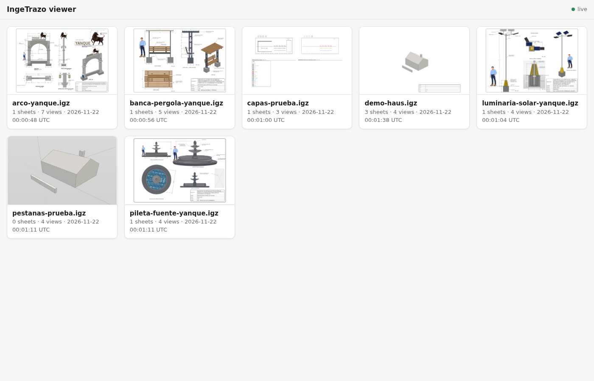
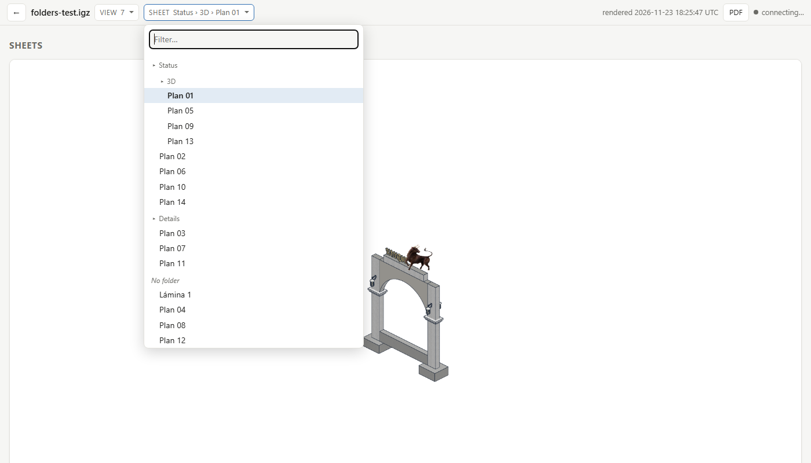
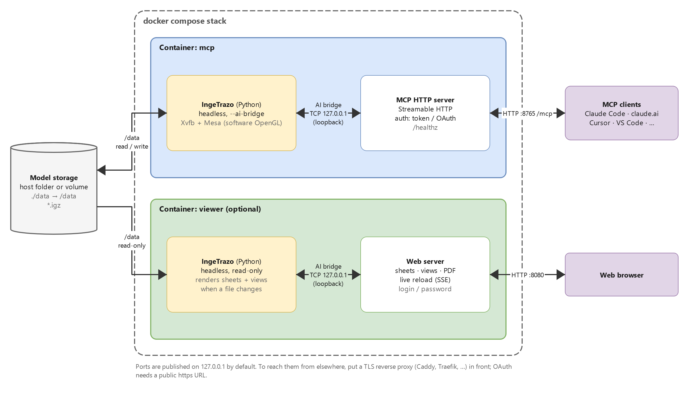

# ingetrazo-docker

Run [IngeTrazo](https://github.com/ingelibre/ingetrazo) — the free push/pull 3D and BIM modeller — **headless in a
container**:

- **MCP server over HTTP**: lets AI agents (Claude Code, Claude Desktop, claude.ai, Cursor, VS Code, …) model,
  query, render and save documents. The tools are IngeTrazo's own (`run_python`, `query_model`, `screenshot`,
  sheets, views, export, …), plus `list_documents` for the data folder.
- **Live viewer (optional)**: a read-only web page with every **sheet** and every **saved view** of every model
  in the data folder. It re-renders and refreshes the page by itself when a file changes.
- **Your models stay in a folder you mount**, e.g. `./data` on the host.

IngeTrazo itself is not modified: the image builds it from a git ref on GitHub.

| Viewer: every model in the data folder | Viewer: one model's sheets and views |
|---|---|
|  |  |

> **Status:** early. Headless mode is in IngeTrazo 0.6.3. The sheet and scene tools come with
> [#1543](https://github.com/ingelibre/ingetrazo/pull/1543),
> [#1544](https://github.com/ingelibre/ingetrazo/pull/1544) and
> [#1545](https://github.com/ingelibre/ingetrazo/pull/1545). Until those are merged, the image
> builds from their branch on the fork, pinned to a commit.

## Quick start

```sh
git clone https://github.com/BastelBaus/ingetrazo-docker
cd ingetrazo-docker
cp .env.example .env
# set MCP_TOKEN in .env, e.g. to the output of: openssl rand -hex 32
mkdir -p data && cp /path/to/*.igz data/

docker compose --profile viewer up -d
```

This pulls the prebuilt image `ghcr.io/bastelbaus/ingetrazo:latest` (amd64 and arm64).
Add `--build` to build it locally instead, e.g. against another `INGETRAZO_REF`.

- MCP: `http://localhost:8765/mcp` (bearer token)
- Viewer: `http://localhost:8080`

Both ports are published on `127.0.0.1` only by default (`MCP_BIND`, `VIEWER_BIND`).

### Connect an MCP client

Claude Code:

```sh
claude mcp add --transport http ingetrazo http://localhost:8765/mcp \
  --header "Authorization: Bearer $MCP_TOKEN"
```

Any client that speaks Streamable HTTP works the same way: URL plus `Authorization` header.

## Configuration

All settings are environment variables. See [`.env.example`](.env.example) for the full list.

| Variable | Default | |
|---|---|---|
| `INGETRAZO_DATA_DIR` | `./data` | Host folder mounted at `/data` |
| `INGETRAZO_MODEL` | – | Document to open at start (relative to `/data`) |
| `INGETRAZO_ALLOW_SAVE` | `true` | Allow `save_document` |
| `INGETRAZO_SAVE_FORMAT` | – | `json` = plain-JSON `.igz`, diffable in git |
| `MCP_AUTH` | `token` | `none`, `token` or `oauth` |
| `MCP_TOKEN` | – | Bearer token, at least 16 characters (`token` mode) |
| `VIEWER_PASSWORD` | – | Viewer password (user `VIEWER_USER`): login page for browsers, Basic auth for scripts |
| `VIEWER_SHEET_DPI` | `120` | Sheet image resolution |
| `INGETRAZO_IMAGE` | `ghcr.io/bastelbaus/ingetrazo:latest` | Image to pull (or tag to build) |
| `INGETRAZO_REPO` / `INGETRAZO_REF` | fork / pinned commit | Which IngeTrazo to build |

## How it works



<sub>The diagram is editable: open `docs/architecture.drawio.png` in [draw.io / diagrams.net](https://app.diagrams.net)
(the diagram is embedded in the PNG) and save it back as PNG. `docs/architecture.drawio` is the same diagram as
XML; `python docs/render_drawio_png.py` re-renders the PNG from it.</sub>

Each container runs one IngeTrazo **without a window** (`--headless --ai-bridge`). It renders with OpenGL in
software (Mesa llvmpipe) inside an in-memory X server (Xvfb).

- **`mcp`**: an HTTP front end. It forwards every MCP request to IngeTrazo's own handler
  (`scripts/ingetrazo_mcp.py` of the cloned app) and talks to the app's AI bridge on the container's loopback.
  The container adds three things: `list_documents`, a check that keeps file paths inside `/data`, and hiding
  `shutdown`. The container's lifetime belongs to Docker. If IngeTrazo exits, the container exits too and the
  restart policy brings it back.
- **`viewer`**: a second, read-only IngeTrazo (data mounted read-only). It watches `/data/**/*.igz` and renders
  each model's sheets as PNG, the sheets as one PDF, and each saved view as PNG into the cache. It serves them as
  web pages, and server-sent events reload an open page when a new render is ready.

Health: `GET /healthz` on both ports, used by the image's `HEALTHCHECK`. For the MCP service it checks that the
IngeTrazo process is alive and that its bridge answers (`document_info`). The check goes through the same
connection as the MCP requests, because the bridge serves one client at a time; during a long tool call it reports
`busy`.

## Security

`run_python` executes arbitrary Python inside the container. Treat MCP access like shell access to the container:

- keep `MCP_AUTH=token` (or `oauth`), never `none` on a reachable port;
- put TLS in front when you publish beyond localhost (a reverse proxy such as Caddy or Traefik);
- the container runs as an unprivileged user, and only `/data`, `/cache` and `/state` are writable.

The path check on `open_document`/`save_document`/exports keeps well-behaved agents inside `/data`. It is not a
sandbox against `run_python`.

## License

GPL-3.0-or-later, like IngeTrazo, which the image contains.
